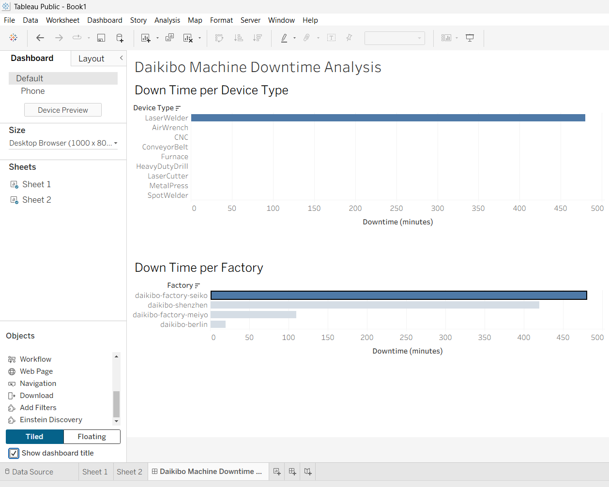

# Deloitte Australia — Data Analytics Job Simulation

**Completed through Forage | October 2026**

This repository contains my work from the Deloitte Australia Data Analytics Job Simulation on Forage. The simulation involved analyzing industrial telemetry data using Tableau and investigating gender pay equality using Microsoft Excel.

## Project Overview

The simulation consisted of two practical tasks focused on data analysis, visualization, and forensic technology.

### Task 1: Data Analysis — Machine Downtime

**Tools:** Tableau Public, JSON

Analyzed telemetry data from Daikibo Industrials to investigate machine downtime across factories and device types.

**Key Activities:**
- Imported and explored machine telemetry data in Tableau.
- Created a calculated field to identify unhealthy machine conditions.
- Built visualizations comparing downtime across factories and device types.
- Developed a dashboard to present the findings.

**Key Findings:**
- Daikibo Factory Seiko recorded the highest downtime.
- LaserWelders experienced the most downtime among machine types.

**Files:** [View Task 1](Task-1-Data-Analysis)

### Task 2: Forensic Technology — Gender Pay Equality

**Tools:** Microsoft Excel

Analyzed employee compensation equality scores to classify potential gender pay disparities across factory locations and job roles.

**Key Activities:**
- Worked with employee compensation equality data.
- Created an additional column called `Equality class`.
- Used conditional logic to classify scores into Fair, Unfair, and Highly Discriminative categories.
- Organized the results in an Excel workbook.

**Files:** [View Task 2](Task-2-Forensic-Technology)

## Skills Developed

- Data Analysis
- Data Visualization
- Tableau Dashboard Development
- Microsoft Excel
- Data Classification
- Analytical Problem-Solving

## Certificate

Successfully completed the **Deloitte Australia Data Analytics Job Simulation** through Forage on **23 October 2026**.

## Disclaimer

This repository documents work completed during a virtual job simulation hosted by Forage. It does not represent employment or an internship with Deloitte.
